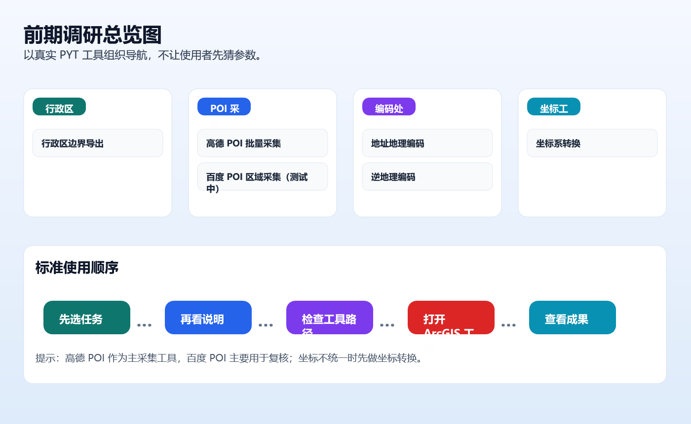
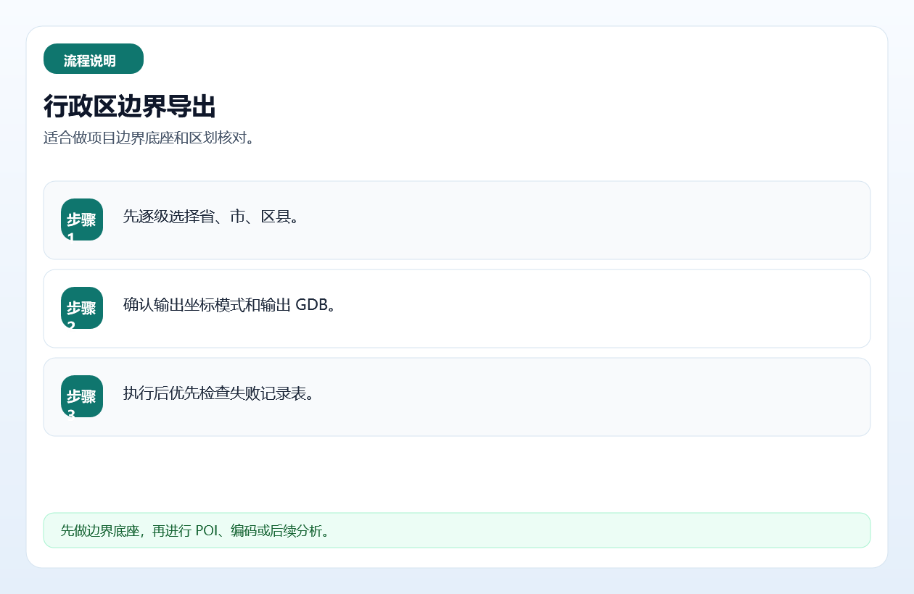
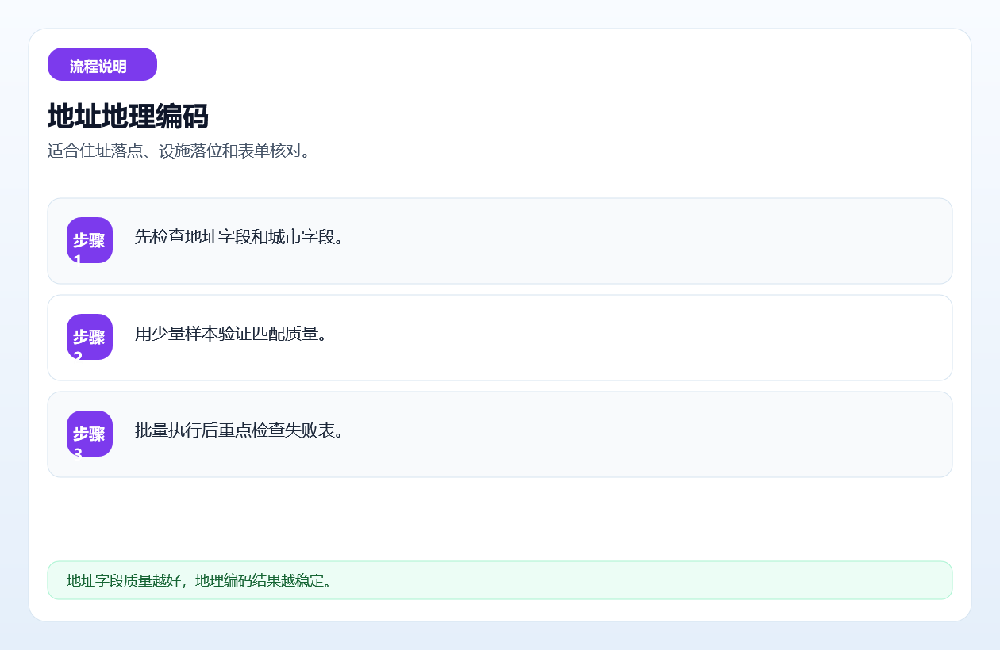
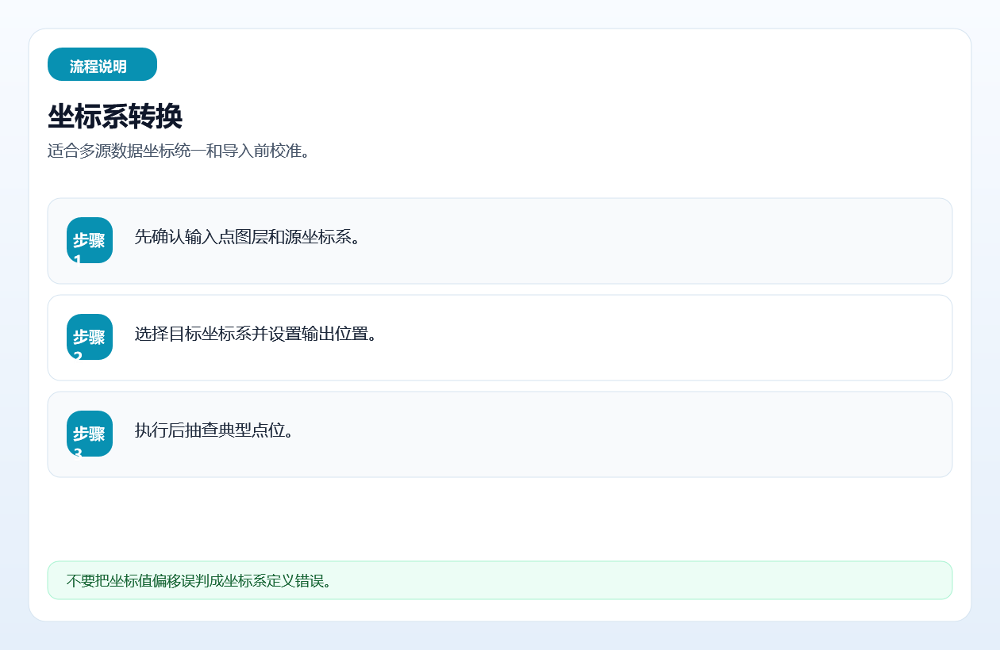
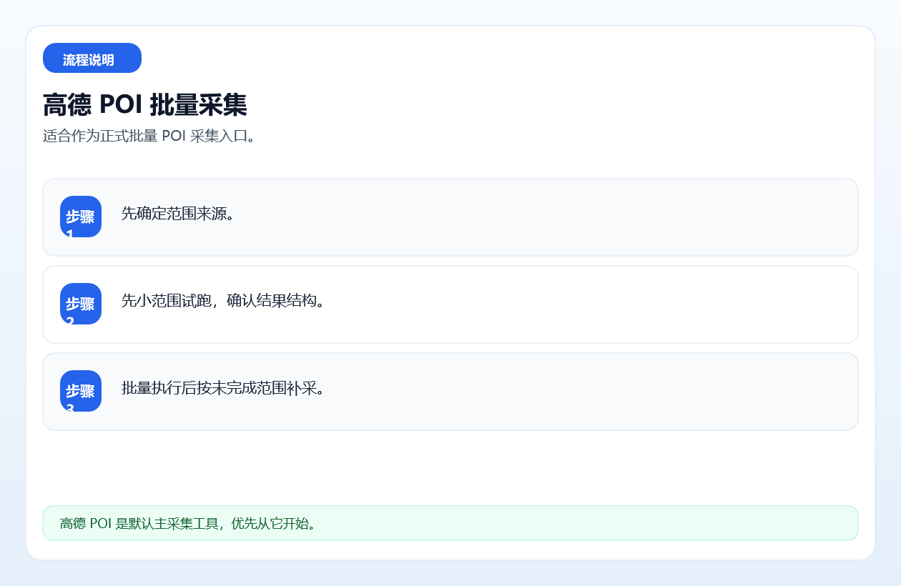
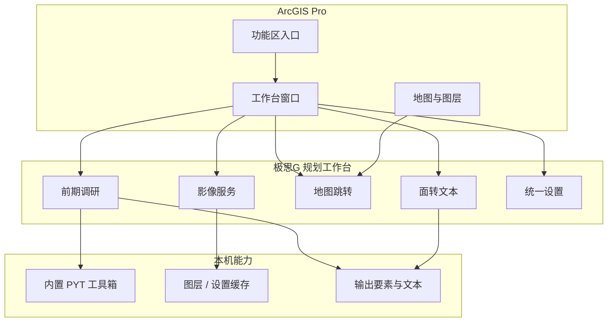

**QQ 交流群：826861025**

<div align="center">
  
  <h1>极思G 规划工作台</h1>
  <p>把前期调研、影像底图、地图跳转和成果整理装进 ArcGIS Pro</p>
  <p>
    <a href="https://github.com/edcfoshan/gispro-planner-assistant/releases"></a>
    
    
    <a href="./LICENSE"></a>
  </p>
</div>

## ❤️ 赞助商

<a href="https://jizhanai.top/register?ref=PBUXGDHTFUAS">
  
</a>

<table>
  <tr>
    <td width="24%" align="center">
      <a href="https://jizhanai.top/register?ref=PBUXGDHTFUAS"></a>
    </td>
    <td>感谢 <a href="https://jizhanai.top/register?ref=PBUXGDHTFUAS"><b>极栈 · jizhanai.top</b></a> 赞助支持本项目！极栈提供 <b>ChatGPT 会员充值</b>服务，支持<b>支付宝支付</b>。选购 <b>ChatGPT 激活码</b>后，按站内指引前往码港兑换。<br><br>通过<a href="https://jizhanai.top/register?ref=PBUXGDHTFUAS">邀请链接注册开通</a>，填写邀请码 <code>PBUXGDHTFUAS</code>，可减 <b>5 元</b>。</td>
  </tr>
</table>



## 30 秒看懂

**极思G 规划工作台**是一个 ArcGIS Pro Add-in，把规划师常用的前期调研、在线影像、地图跳转、面转文本和系统设置放进同一个工作台，减少在网页、工具箱、地图窗口和文件目录之间反复切换。

它不是“大而全的 GIS 平台”，而是一套围绕真实规划作业流的桌面入口：需要查区位和设施时用前期调研，需要看底图时切换影像，需要复核位置时跳转百度 / 高德，需要整理地块时用面转文本。

> 当前是 `0.1.0-demo.1` 社区预览版。部分模块仍是骨架或实验功能，不应直接承担生产交付。

## 功能矩阵

| 模块 | 你能做什么 | 状态 | 入口 |
| --- | --- | --- | --- |
| 前期调研 | 行政区核对、POI 采集、地理编码 / 逆地理编码、坐标系转换，双源结果统一排序 | Demo 可用 | 「作业台 → 前期调研」 |
| 影像底图 | 天地图、吉林一号年度一张图、Esri 世界影像、WFS 服务接入；支持密钥分区与图层缓存 | Demo 接入 | 「在线瓦片服务」 |
| 地图跳转 | 在地图中选点后跳转百度 / 高德地图或街景 | Demo 可用 | 「地图跳转」 |
| 面转文本 | 将面要素导出为可读文本 | 实验功能 | 「成果整理」 |
| 系统设置 | 统一管理工具路径、输出库、UI 密度、日志和密钥 | Demo 可用 | 「设置」 |
| 检查更新 | 查询最新 Release，有新版本时打开下载页 | Demo 可用 | 「检查更新」 |



## 安装

到 [GitHub Releases](https://github.com/edcfoshan/gispro-planner-assistant/releases) 下载 `JisigG-Planner-Workbench_0.1.0-demo.1_x64.esriAddinX`，双击安装，重启 ArcGIS Pro。

| 步骤 | 操作 |
| --- | --- |
| 1 | 下载 `.esriAddInX`，必要时核对 Release 中的 SHA256 |
| 2 | 关闭 ArcGIS Pro 相关窗口 |
| 3 | 双击 `.esriAddInX` 安装 |
| 4 | 重启 ArcGIS Pro，在功能区打开「极思G 规划工作台」 |

Demo 不在 ArcGIS Pro 运行期间静默覆盖 Add-in。升级时先点击「检查更新」，下载新包后双击安装并重启 Pro。

## 核心能力

### 前期调研

前期调研把区位、设施和地址信息整理成可落图的结果。你可以选择百度、高德或双源模式，执行行政区核对、POI 检索、地址转坐标、坐标转附近信息等任务。

| 能力 | 说明 |
| --- | --- |
| 行政区边界核对 | 按行政区层级查询并检查边界结果 |
| POI 采集 | 按关键词 / 分类获取百度或高德 POI |
| 地理编码 | 地址表批量转换为坐标 |
| 逆地理编码 | 坐标转换为附近位置信息 |
| 坐标转换 | GCJ-02 / BD-09 → WGS84，便于 GIS 叠合 |
| 双源排序 | 同一任务合并百度与高德结果并统一排序 |





### 影像底图

支持天地图、吉林一号年度一张图、Esri 世界影像和 WFS 服务接入。基础密钥以加密形式随包分发，需要管理员密码解锁；用户也可以填写自己的补充密钥。

| 服务 | 用途 |
| --- | --- |
| 天地图 | 国内基础影像底图 |
| 吉林一号 | 年度一张图与变化观察 |
| Esri 世界影像 | 全球范围参考底图 |
| WFS | 接入自建或第三方要素服务 |

图层缓存用于减少重复请求；不同服务分区管理密钥，便于按项目隔离账号与配额。

### 地图跳转与成果整理

地图跳转用于把 ArcGIS Pro 里的候选位置快速带回百度 / 高德网页或街景，适合现场核验、交通观察和周边环境判断。面转文本用于把面要素导出为更易检查和传递的文本结果；当前仍属实验功能，建议先小范围试导出。



## 密钥与数据边界

| 项目 | 当前处理 |
| --- | --- |
| 天地图 / 吉林一号基础密钥 | AES-GCM 加密后随安装包分发 |
| 基础密钥解锁 | 需要管理员密码；Demo 暂不公开密码 |
| 百度 / 高德 Key | 用户可在设置中填写自己的 Key |
| 输出数据 | 写入用户指定位置，不由项目服务器托管 |
| 日志与截图 | 提交 Issue 前必须脱敏 |

请勿在 Issue、PR 或聊天群中提交明文 Key、管理员密码、`keys.local.json` 或业务敏感数据。安全问题描述请参考 [SECURITY.md](SECURITY.md)。

## 兼容与限制

| 项目 | 当前说明 |
| --- | --- |
| 实测环境 | ArcGIS Pro 3.5.2 |
| 目标范围 | ArcGIS Pro 3.4 / 3.5；其他版本待验证 |
| 自动覆盖安装 | 不支持；采用检查更新 + 手动安装新包 |
| 模块成熟度 | 部分模块仍为骨架或实验功能 |
| 生产交付 | 当前 Demo 不应直接承担生产成果质量控制 |

## 架构



| 层 | 说明 |
| --- | --- |
| ArcGIS Pro | 承载功能区、地图、图层和 Add-in 生命周期 |
| .NET 8 WPF | 实现工作台窗口、按钮和服务编排 |
| 内置工具箱 | 前期调研依赖 `ArcGISpro-baidu-amap-geocode-pyt` |
| 本地存储 | 保存设置、缓存和输出结果 |
| GitHub Releases | 分发 `.esriAddInX` 与 SHA256 校验文件 |

## 从源码构建

```bash
git clone --recurse-submodules https://github.com/edcfoshan/gispro-planner-assistant.git
cd gispro-planner-assistant
dotnet build GisProAddinWorkbench.sln -c Release
```

如果已经克隆过仓库，可同步内置工具箱：

```bash
git submodule update --remote
```

| 依赖 | 用途 |
| --- | --- |
| .NET SDK 8.0+ | 构建 Add-in |
| ArcGIS Pro 3.4 / 3.5 | 运行与实测 |
| Git submodules | 引入前期调研使用的地理编码工具箱 |

## 文档

| 文档 | 内容 |
| --- | --- |
| [快速安装与升级](docs/guides/install-and-update.md) | 安装、升级和注意事项 |
| [使用教程](docs/guides/getting-started.md) | 从一次前期调研开始 |
| [发布说明](docs/guides/release-notes-0.1.0-demo.1.md) | 当前 Demo 功能与限制 |
| [架构说明](docs/architecture.md) | 模块与数据流 |
| [交接文档](docs/handover.md) | 开发环境与维护信息 |

## 社区反馈

| 场景 | 入口 |
| --- | --- |
| 可复现缺陷、兼容问题 | [GitHub Issues](../../issues) |
| 工作流建议、功能讨论 | [GitHub Discussions](../../discussions) |
| 一般交流 | QQ 交流群：826861025 |

提交问题时请附 ArcGIS Pro 版本、Windows 版本、Add-in 版本、操作步骤和脱敏日志。

## 关注与赞赏

扫码关注「极思G工作室」公众号、加入 QQ 交流群，获取工具更新、交流使用经验：


如果这些工具对你有帮助，欢迎赞赏支持。赞赏完全自愿，感谢你的支持。


## License

[MIT](./LICENSE)

ArcGIS、ArcGIS Pro 是 Esri 的商标；百度地图、高德地图等名称属于其各自所有者。本项目与这些平台无隶属关系。
