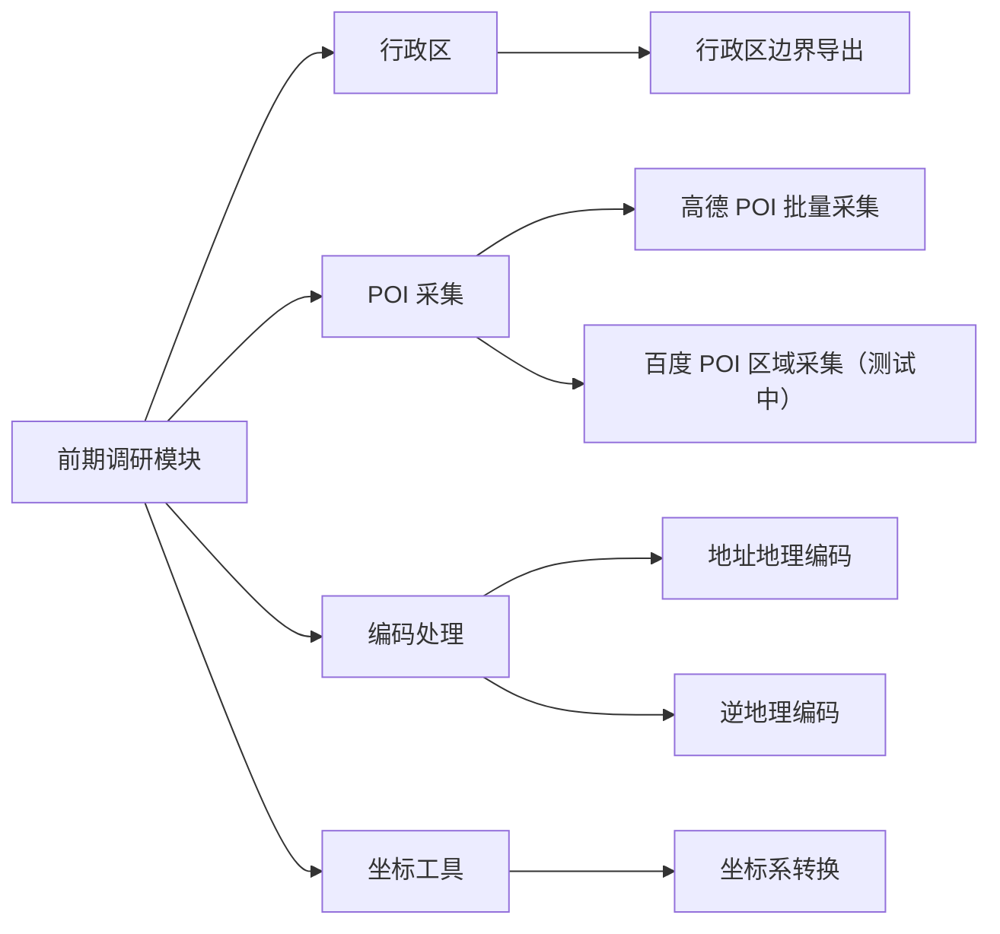

# 前期调研模块可视化说明

本文档对应插件中的“前期调研”模块，说明新的信息架构、工具映射和图示资产。

## 模块结构

## 使用流程

## 工具对照

| 分组 | 用户名称 | PYT 工具类 | 典型用途 | 状态 |
| --- | --- | --- | --- | --- |
| 行政区 | 行政区边界导出 | `AdminAreaBoundaryExport` | 项目边界底座、区划核对 | 推荐 |
| POI 采集 | 高德 POI 批量采集 | `AmapPoiInExtent` | 正式批量 POI 采集 | 常用 |
| POI 采集 | 百度 POI 区域采集 | `BaiduPoiInExtent` | 双源复核、补充采集 | 测试中 |
| 编码处理 | 地址地理编码 | `GeocodeToWgs84Points` | 地址表落点 | 常用 |
| 编码处理 | 逆地理编码 | `ReverseGeocodeToPoi` | 点位反查附近信息 | 辅助 |
| 坐标工具 | 坐标系转换 | `CoordTransformPoints` | 多源坐标统一 | 基础 |

## 图示资产

插件内与仓库共用以下 PNG 资产：

- `Images/Guide/survey-overview.png`
- `Images/Guide/survey-tool-quick-reference.png`
- `Images/Guide/survey-card-admin-area.png`
- `Images/Guide/survey-card-amap-poi.png`
- `Images/Guide/survey-card-baidu-poi.png`
- `Images/Guide/survey-card-address-geocode.png`
- `Images/Guide/survey-card-reverse-geocode.png`
- `Images/Guide/survey-card-coord-transform.png`
- `Images/Guide/survey-guide-admin-area.png`
- `Images/Guide/survey-guide-amap-poi.png`
- `Images/Guide/survey-guide-baidu-poi.png`
- `Images/Guide/survey-guide-address-geocode.png`
- `Images/Guide/survey-guide-reverse-geocode.png`
- `Images/Guide/survey-guide-coord-transform.png`

这些图示遵循同一原则：少讲接口名，多讲“什么时候用、输入什么、会得到什么”。
